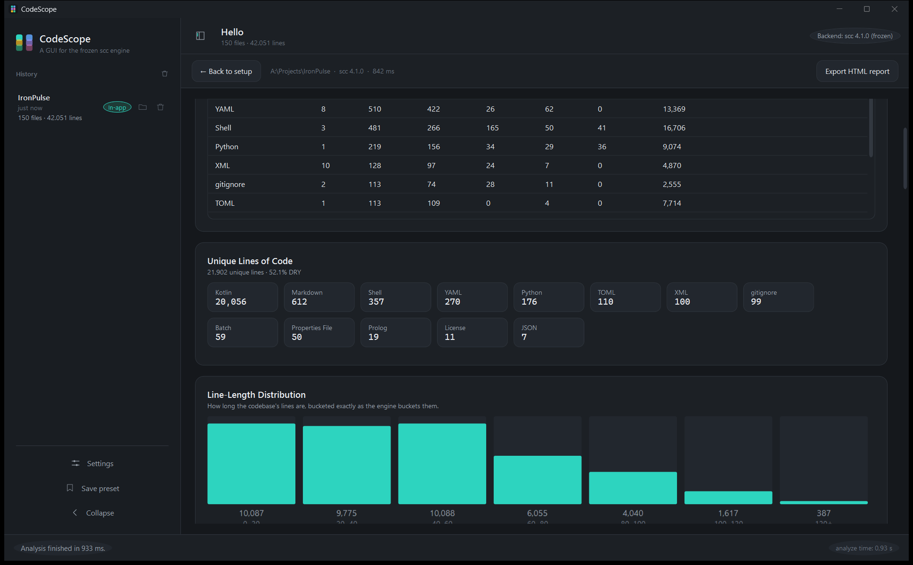
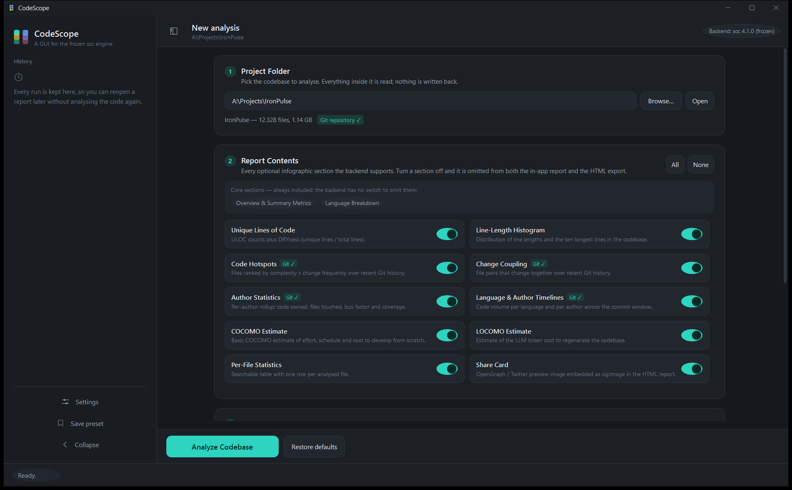

# CodeScope

A native Windows desktop application for the [scc](https://github.com/boyter/scc)
code-analysis engine. It analyses a codebase with the pinned, frozen engine and
presents the result either as a rich in-app dashboard or as scc's own
self-contained HTML infographic.





> **CodeScope is not affiliated with or endorsed by the scc project.** It is an
> independent front end for the MIT-licensed engine, which it bundles verbatim.

---

## Contents

- [Requirements](#requirements)
- [Quickstart](#quickstart)
- [What it does](#what-it-does)
- [The two output modes](#the-two-output-modes)
- [Report sections](#report-sections)
- [Building from source](#building-from-source)
- [The frozen backend](#the-frozen-backend)
- [Repository layout](#repository-layout)
- [Tests](#tests)
- [Design notes](#design-notes)
- [Contributing](#contributing)
- [Licence](#licence)

---

## Requirements

| | |
| --- | --- |
| **To run the app** | Windows 10 (1809 or later) or Windows 11, x64 |
| **The .NET 8 Desktop Runtime (x64)** | **Required** — the app is published framework-dependent, so the runtime must be installed |
| **Go toolchain** | *Not* required to run the app. The engine ships pre-built |
| **Network access** | *Not* required. The app never phones home |
| **An scc installation** | *Not* required. The engine is bundled |

### Will a normal Windows computer already have the runtime?

**No.** This is the one thing worth reading before you download.

A stock Windows 10 or 11 machine ships the **.NET Framework 4.8**, which is a
different thing from the modern **.NET 8** runtime, and it cannot run this
application. .NET Framework is what powers the classic desktop applications
that shipped with Windows; .NET 8 is the current runtime and it is *not*
preinstalled.

Installing it is a one-time, per-machine step of about a minute:

1. Download **.NET Desktop Runtime 8 (x64)** from
   <https://dotnet.microsoft.com/download/dotnet/8.0> (choose *Windows* → *x64*
   → *Runtime*).
2. Run the installer.
3. Start `CodeScope.exe`.

Check what you already have with `dotnet --list-runtimes`. If a line starting
with `Microsoft.WindowsDesktop.App 8.` is listed, you are done.

**If you would rather not install anything:** the self-contained build ships the
whole runtime inside the application. It is about 190 MB instead of 28 MB, and it
runs on a clean Windows machine with no prerequisites at all:

```powershell
powershell -ExecutionPolicy Bypass -File build\publish.ps1 -SelfContained
```

---

## Quickstart

1. Install the [.NET 8 Desktop Runtime (x64)](https://dotnet.microsoft.com/download/dotnet/8.0).
2. Unzip the release. You get `CodeScope.exe` and a `backend\` folder.
3. Double-click `CodeScope.exe`.
4. A four-step introduction appears on the first launch — it explains the app and
   can be skipped at any point. It never comes back.
5. **Browse…** to a folder, press **Analyze Codebase**, and read the report.

The app never writes to the folder you analyse. The in-app report writes
nothing at all; the HTML export writes exactly one `.html` file, to a folder
you choose — or beside the analysed code if you leave the folder empty.

---

## What it does

* **Pick a folder** with the native Windows folder picker; the app validates it
  and detects whether it lives inside a Git repository.
* **Choose the report contents.** Every optional section the pinned backend
  supports has its own switch. Turning one off omits it from *both* output
  modes — the section really is absent, never merely hidden.
* **Fine-tune the analysis.** Ignores, extension filters, large-file limits,
  minified/generated detection, language remapping, ULOC, cognitive complexity,
  COCOMO and LOCOMO parameters, Git window depth and worker tuning. The switches
  the engine's own report path ignores — its sort order, coupling weighting and
  blast-radius view — are deliberately not offered, because they would change
  nothing in either output mode.
* **Read the results natively.** Metric cards, a language distribution bar, the
  line-length histogram, hotspot and coupling tables, the author rollup with bus
  factor, language and author timelines, the cost models and a searchable
  per-file table. Double-click a row in any file-bearing table — per-file
  statistics, longest lines, code hotspots or change coupling — to open that
  file in File Explorer; in the coupling table the file under the pointer wins.
  Every table sorts by its column headings, and the heading that is sorted
  carries an arrow that points the way the rows run.
* **Export HTML.** Type the report file name, choose the output folder with the
  native picker, then run the analysis. "Save as" remembers the name and
  confirms it inline; an existing file is never replaced without an explicit
  confirmation. Exporting from the report itself opens a small themed dialog
  that asks for the file name and the folder; leaving the folder empty writes
  the report beside the analysed code.
* **Keep the history.** Every finished run is stored in the application-data
  folder — the folder that was analysed, the totals, the timing and the engine's
  own report data. The sidebar lists them; click one to reopen that report
  exactly as it was produced, without running the engine again. The last thirty
  runs are kept, so the folder cannot grow without bound.
* **A walkthrough on the first launch.** A four-step introduction explains what
  the app does, asks for the folder to analyse and shows what a preset covers.
  It can be skipped at any point and never comes back.
* **Presets and themes.** Four built-in presets plus your own, and Dark / Light /
  Follow System with the choice remembered between launches.

---

## The two output modes

|  | In-app report | HTML export |
| --- | --- | --- |
| Produced by | `codescope-export.exe` → JSON → WPF | `scc.exe --report=<path>` |
| Files written | none, ever | one `.html`, where you choose |
| Section selection | `--report-skip` | `--report-skip` |
| Share card (`og:image`) | n/a — it is an HTML concept | included unless switched off |

Both modes run from the same configuration object, so the numbers and the
section selection can never drift apart.

### Report sections

| Section | `--report-skip` | Needs Git |
| --- | --- | --- |
| Overview & summary metrics | *core — always present* | no |
| Language breakdown | *core — always present* | no |
| Unique lines of code (ULOC / DRYness) | `uloc` | no |
| Line-length histogram | `linelength` | no |
| Code hotspots | `hotspots` | **yes** |
| Change coupling | `coupling` | **yes** |
| Author statistics & bus factor | `authors` | **yes** |
| Language & author timelines | `timeline` | **yes** |
| COCOMO estimate | `cocomo` | no |
| LOCOMO estimate | `locomo` | no |
| Per-file statistics | `files` | no |
| Share card (`og:image`) | `card` | no |

The two *core* sections are not optional in scc: the backend has no switch to
omit its totals strip or its language table, so the app presents them as always
included rather than offering a switch that could not be honoured. Every
optional section has a real switch, and it works.

When the chosen folder is not inside a Git repository, the four history sections
say so on their toggle and the report explains which sections could not be
produced. Nothing is invented: the engine returns empty history data and the app
shows that fact.

---

## Building from source

You need:

* the **.NET 8 SDK** (8.0.4xx or later) — <https://dotnet.microsoft.com/download/dotnet/8.0>
* the **Go toolchain** matching `vendor/scc-source/go.mod` (1.26.4) — only to
  rebuild the bundled engine
* **Windows PowerShell 5.1** or later

```powershell
git clone <your fork>
cd CodeScope

# 1. build the two bundled executables from the frozen snapshot
powershell -ExecutionPolicy Bypass -File build\build-backend.ps1

# 2. build the application and run the test suite
powershell -ExecutionPolicy Bypass -File build\build.ps1

# 3. publish
powershell -ExecutionPolicy Bypass -File build\publish.ps1
#    ...or, with the runtime included:
powershell -ExecutionPolicy Bypass -File build\publish.ps1 -SelfContained
```

The published folder lands in `publish\CodeScope\`.

The application carries **no NuGet packages**. JSON, process hosting, theming,
charts and dialogs are all built on the .NET 8 BCL and WPF, so `dotnet build`
and `dotnet publish` work with no package feed at all — the lock file records
exactly that.

### Docker

The repository contains a `Dockerfile` that reproduces the build and the test
run inside a Windows container:

```powershell
docker build -t codescope .
docker run --rm codescope
```

The container builds and tests; it does not run the interface, because a
graphical application needs a Windows desktop session.

---

## The frozen backend

| | |
| --- | --- |
| Upstream | <https://github.com/boyter/scc> |
| Commit | `36b47298e436feec174330a3b7160df61087799f` |
| Version | `4.1.0` (`v4.1.0-12-g36b4729`) |
| Snapshot | `vendor/scc-source/` — 2,010 files, byte-for-byte |
| Hashes | `vendor/scc-source/SNAPSHOT-SUMS.sha256` |

Two executables are built from that snapshot and bundled with the application:

* **`backend\scc.exe`** — the upstream CLI, unmodified. It renders the HTML
  report and answers `--version`.
* **`backend\codescope-export.exe`** — a small adapter, also built from the
  snapshot, that drives `processor.CollectReportData` — the very function scc's
  own `--report` calls — and prints the result as JSON.

The adapter exists because the CLI's structured formats do not cover the whole
infographic: `--format json`/`json2` drop the line-length histogram and the
per-language ULOC rollup, and no JSON format exposes the Git-history tables.
Reusing the engine's own report entry point means every number in the dashboard
comes from the frozen engine rather than a re-implementation. No upstream file
is modified — see `vendor/scc-source/SNAPSHOT.md`.

To move the pin forward, follow `BACKEND-UPDATE.md`.

---

## Repository layout

```
.
├── .github/                 workflows, issue and pull-request templates
├── .editorconfig            one formatting rule set for every editor
├── .gitattributes           line endings and binary handling
├── .gitignore               build output, secrets, editor caches
├── CHANGELOG.md             version history, following Keep a Changelog
├── CODE_OF_CONDUCT.md       the Contributor Covenant
├── CONTRIBUTING.md          how to set up, branch and propose a change
├── Dockerfile               reproducible build-and-test image
├── LICENSE                  MIT, for this repository
├── SECURITY.md              how to report a vulnerability privately
├── THIRD-PARTY-NOTICES.md   the licences of everything that is bundled
├── CodeScope.sln
├── backend/                 where the two executables are built into
├── build/
│   ├── build-backend.ps1    rebuild both executables from the snapshot
│   ├── build.ps1            build + test
│   ├── publish.ps1          publish the application
│   └── adapter/main.go      copy of the adapter kept outside the snapshot
├── docs/                    screenshots
├── src/CodeScope.App/
│   ├── Controls/            reusable controls (collapsible card, icons)
│   ├── Models/              section catalogue, options, report data contract
│   ├── Services/            process host, argument builder, settings, history
│   ├── ViewModels/          MVVM view models
│   ├── Views/               configuration, dashboard, walkthrough, settings
│   ├── Resources/           theme dictionaries, control styles, icon geometry
│   └── Converters/
├── tests/CodeScope.Tests/   dependency-free test suite (unit + integration)
├── vendor/scc-source/       frozen upstream snapshot + provenance
├── BACKEND-UPDATE.md        how to move the pin forward
└── README.md
```

---

## Tests

```powershell
powershell -ExecutionPolicy Bypass -File build\build.ps1          # build + test
powershell -ExecutionPolicy Bypass -File build\build.ps1 -SkipBackend
dotnet run --project tests\CodeScope.Tests                       # just the suite
```

The suite has no test-framework dependency: it is a console program that returns
a non-zero exit code on failure.

**Unit** — argument construction (flags emitted, invariant number formatting,
comma-joined lists, paths with spaces and non-ASCII characters surviving
intact), section/skip-list mapping, settings and preset persistence including a
corrupt settings file, the preset catalogue and display formatting, the
analysis history (round trip, the thirty-run cap, removal, a damaged file never
hiding the rest) and the first-run flags.

**Integration** — the real executables against throwaway fixtures:

* both bundled executables report the same version and start cleanly;
* a project whose path contains a space and non-ASCII characters;
* `--count-as`, `--include-ext` and the wage parameters changing the output;
* a real Git repository: hotspots, coupling, authors, bus factor and both
  timelines populated; `--depth` honoured;
* a folder with no repository: the history sections come back empty rather than
  fabricated;
* section selection removing exactly the sections that were switched off, in
  both modes;
* `--report-skip` removing the matching headings from the HTML report;
* an existing report refused without consent and replaced with it;
* the in-app mode writing no file anywhere;
* the adapter's totals matching `scc --format json2` run by hand;
* cancellation and clean failure reporting for a missing folder.

---

## Design notes

* **Native folder picker.** `Microsoft.Win32.OpenFolderDialog` — the shell's
  own common item dialog, not a re-implemented tree view.
* **Process invocation.** Arguments go through `ProcessStartInfo.ArgumentList`,
  never a shell string, so a path with spaces, quotes or non-ASCII text cannot
  be re-parsed. Both streams are drained concurrently, and cancellation kills
  the process tree.
* **Progress.** The engine reports no per-file progress, so the status bar shows
  an indeterminate bar and says so, alongside the real phase the app is in.
* **Themes.** Colours live in `Resources/Themes/*.xaml` and every style resolves
  them through `DynamicResource`, so switching themes re-skins the application —
  including the dashboard — immediately. "Follow system" tracks the Windows app
  theme and updates when it changes.
* **Settings** live in `%LOCALAPPDATA%\CodeScope\settings.json` and
  `presets\`, never inside an analysed project. A corrupt file falls back to
  defaults instead of blocking startup.
* **History** lives in `%LOCALAPPDATA%\CodeScope\history\`, one JSON file per
  run. Each file holds the report data, so a run can be reopened without
  re-running the engine; the store caps the log at thirty entries.
* **Motion.** Every interaction is animated, but only where it helps: the
  sidebar glides open and closed, views lift into place, buttons and switches
  respond on hover and press, the expandable card grows while its chevron
  turns, and the walkthrough fades between its steps. Feedback is drawn as a
  themed overlay whose opacity is animated, so the behaviour is identical in
  both themes.
* **Icons** are vector paths on a shared 24-unit grid, drawn by one control, so
  the whole set keeps the same weight and nothing is ever cropped.
* **Privacy.** The app makes no network request of any kind. Nothing about the
  analysed codebase leaves the machine.

---

## Contributing

See [CONTRIBUTING.md](CONTRIBUTING.md) for the development setup, the branching
rules and the pull-request workflow, [CODE_OF_CONDUCT.md](CODE_OF_CONDUCT.md) for
the behaviour we expect from everyone taking part, and
[SECURITY.md](SECURITY.md) for reporting a vulnerability privately.

---

## Licence

CodeScope is released under the [MIT licence](LICENSE).

The bundled engine is a separate work by Ben Boyter and is also MIT licensed;
its notice travels with the build in `vendor\scc-source\LICENSE`. The complete
list of third-party licences is in
[THIRD-PARTY-NOTICES.md](THIRD-PARTY-NOTICES.md).
